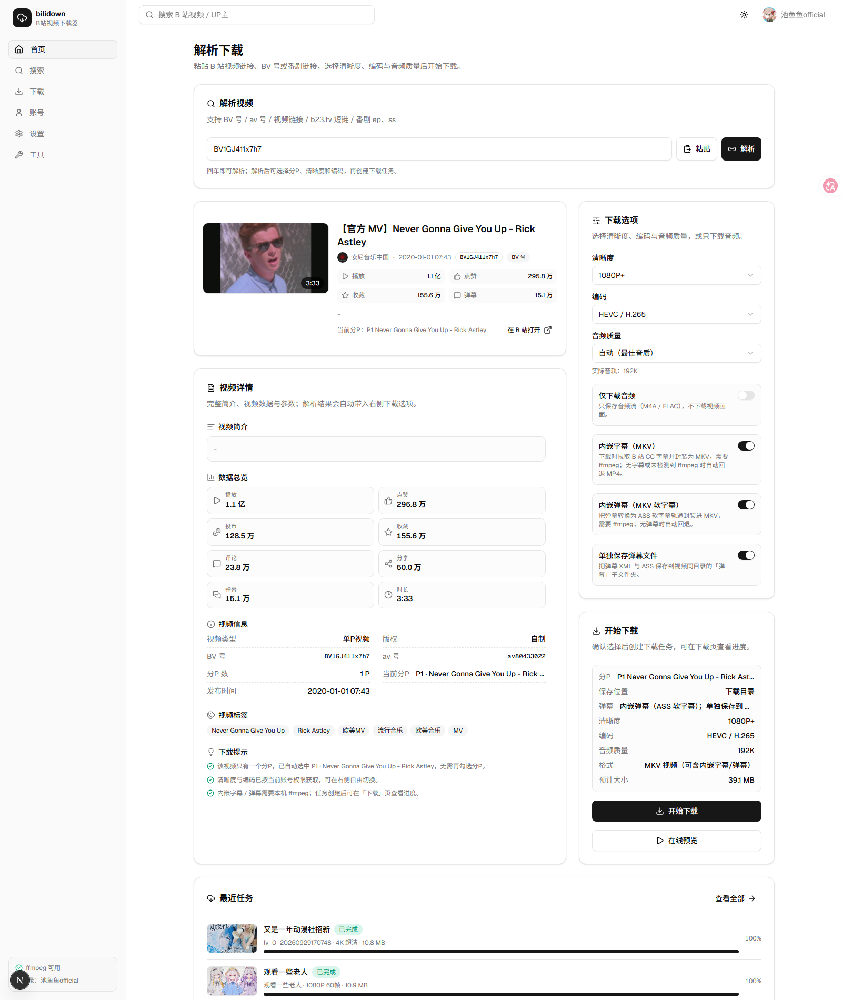
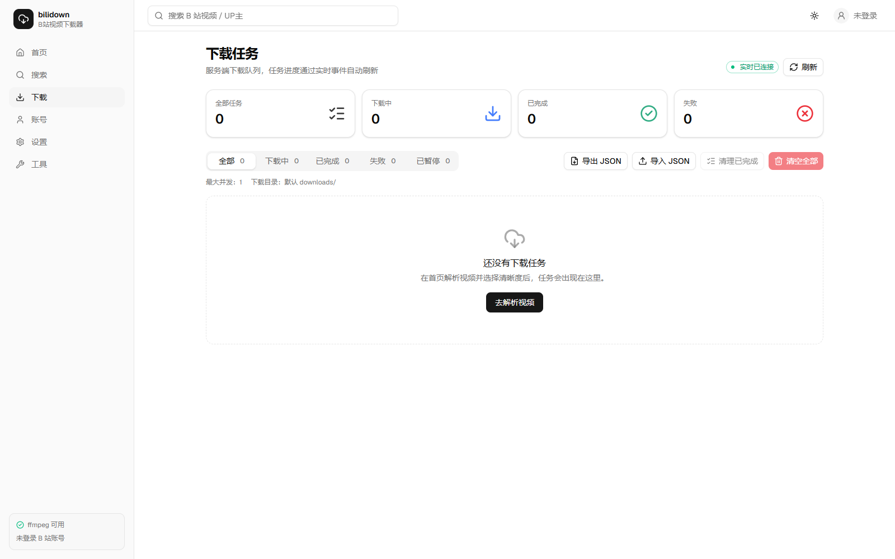
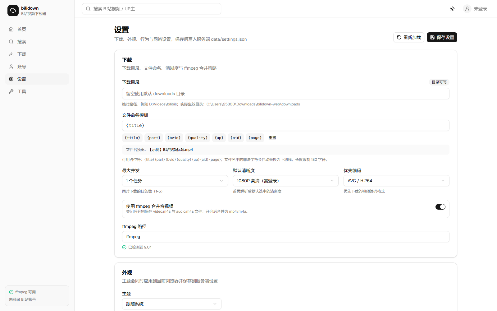
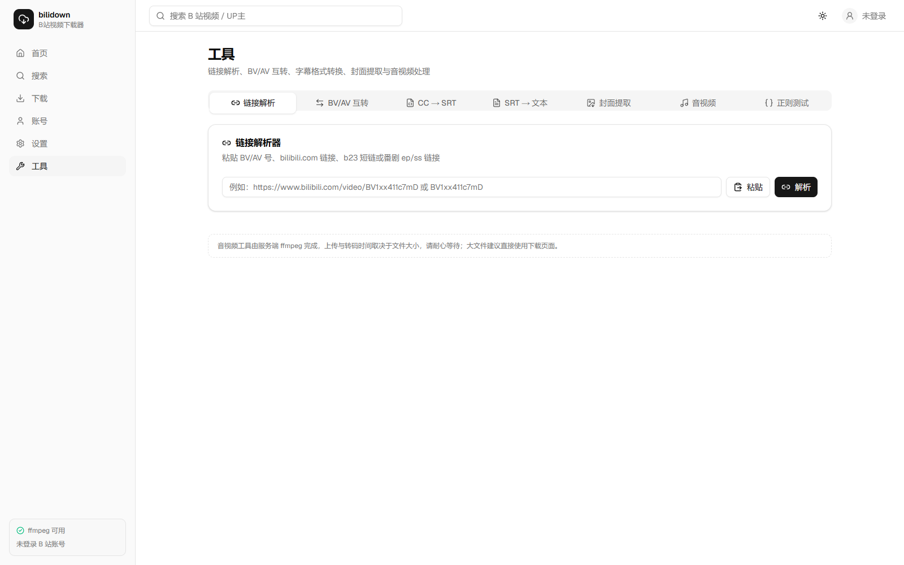
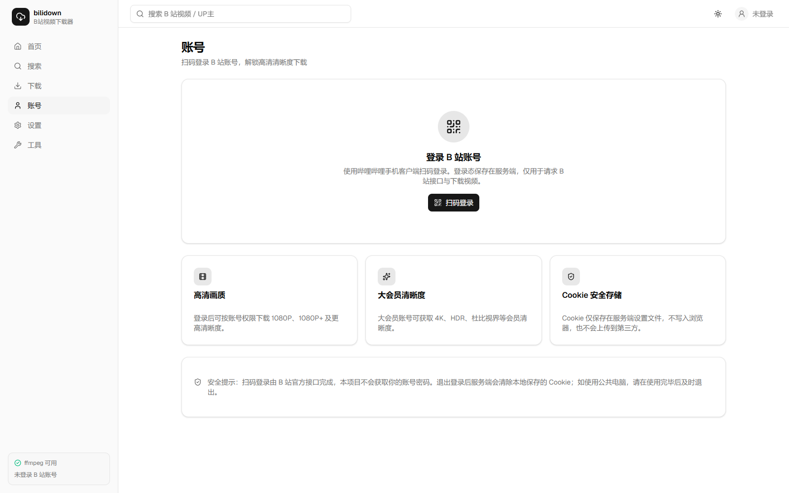

# bilidown-web

把 Electron 桌面应用 **bilidown 1.2.6**（B站视频下载器）迁移为 **Next.js + shadcn/ui** 网站，并附带 **Electron 桌面版壳**：同一套代码既可用浏览器访问，也可打包成 Windows 桌面应用，直接使用本机下载目录、系统托盘、协议链接、通知与关机等本地能力。

原应用（Electron `app.asar`）先经过解包与可读化还原，再逆向出完整规格（`docs/original-spec.md`）→ 按规格重建本仓库（`docs/blueprint.md` 为迁移设计蓝图）。逆向过程产物未包含在仓库中，仓库只保留可运行源码与规格文档。

## 技术栈

| 层 | 技术 |
|---|---|
| 前端 | Next.js 16 App Router · React 19 · TypeScript strict · Tailwind CSS v4 · shadcn/ui（radix）· lucide-react · sonner · **ffmpeg.wasm**（服务端没有 ffmpeg 时在浏览器内无损合并音视频） |
| 服务端（替代原 Electron 主进程） | Next.js Route Handlers（Node runtime）· B站 API 代理（UA/Referer/Cookie）· 服务端下载引擎（fetch 流式下载 DASH）· ffmpeg 合并 · JSON 持久化 · SSE 进度推送 |
| 桌面壳（Electron） | Electron 44 · 内嵌 Next standalone 服务 · preload + contextBridge 白名单 IPC · 托盘 / 通知 / 目录选择 / 资源管理器 / `bilidown://` 协议 / 自动关机 |
| 数据存储 | `data/tasks.json`（任务）、`data/settings.json`（设置含登录 Cookie）；桌面版存放在用户数据目录 |
| 下载文件 | 默认 `downloads/`，可在设置页改为任意绝对路径 |

## 界面预览

| 首页（解析 + 下载选项） | 搜索（增强功能） |
|---|---|
|  |  |

| 下载任务（SSE 实时进度） | 设置 |
|---|---|
|  |  |

| 工具（7 个实用工具） | 账号（扫码登录） |
|---|---|
|  |  |

> 截图来自生产构建（`next start`）+ Edge headless 实拍，位于 `screenshots/`。

## 快速开始

要求：Node.js ≥ 20、npm；**ffmpeg 是可选项**——装了就用服务端 ffmpeg 合并；没装时服务端会分别保存音视频分片，可在下载页点「浏览器合并」，用浏览器（含手机网页端）里的 ffmpeg.wasm 无损合成 MP4，无需在服务器安装 ffmpeg。

```powershell
cd bilidown-web
npm install
npm run dev          # 开发模式，默认 http://localhost:3000
npm run build        # 生产构建
npm run start        # 生产启动（standalone 启动器，默认 3000；可用 -- --port 3100 指定端口）
```

启动后在浏览器打开对应地址即可。首页粘贴 B 站视频链接/BV/av 号/b23 短链/番剧 ep、ss 即可解析下载。

### 桌面版（Electron）

```powershell
# 开发模式：同时启动 Next dev(3100) 与 Electron 窗口
npm run electron:dev

# 构建后以桌面模式运行（内嵌 standalone 服务，不依赖 next start）
npm run build
npm run electron:start

# 冒烟测试：启动内嵌服务 + 窗口，校验页面渲染与 preload 桥接后自动退出
npm run electron:smoke

# 打包 Windows 便携版 exe（输出 release/bilidown-0.2.0-portable.exe，约 142MB）
npm run electron:build
```

## 功能

| 路由 | 功能 |
|---|---|
| `/` 首页 | 解析任意输入（BV/av/链接/b23 短链/ep/ss）→ 展示视频信息、封面、UP主、统计、**分P列表与合集（ugc_season）剧集列表** → 勾选分P/合集批量下载、清晰度、编码（AVC/HEVC/AV1）、仅音频、**内嵌弹幕 / 单独保存弹幕文件** → 批量创建下载任务（列表下载按列表名建子文件夹）；官方 iframe 在线预览；最近任务 |
| `/search` 搜索 | **增强功能**（原桌面版没有关键词搜索接口）：B站关键词搜索（视频/UP主、排序、分页）；搜索不可用时可直接回首页粘贴链接 |
| `/downloads` 下载 | 任务统计 + 状态 Tabs；实时进度（SSE）、速度、剩余时间；暂停/继续/取消/重试/删除；下载文件、复制路径；**列表名 / 内嵌弹幕 / 弹幕文件徽标与弹幕数量、弹幕文件夹路径**；**服务端无 ffmpeg 时的「浏览器合并」（ffmpeg.wasm，手机网页端可用）与音视频分片单独下载**；导出/导入 JSON、清理已完成、清空全部 |
| `/account` 账号 | B站扫码登录（服务端保存 Cookie）、用户信息、退出登录；登录后可下载 1080P+ 等高清清晰度 |
| `/settings` 设置 | 下载目录、命名模板、最大并发、默认清晰度、优先编码、ffmpeg 检测、合并开关、字幕内嵌、**列表单独文件夹、弹幕内嵌、单独保存弹幕、弹幕字号/不透明度**、主题（浅色/深色/跟随系统）、剪贴板监听、自动检查更新、代理、清空记录/恢复默认 |
| `/tools` 工具 | 链接解析、BV ⇄ AV 互转、CC 字幕 JSON → SRT、SRT → 纯文本、封面提取、音频转 MP3、音视频手动混流、正则测试 |

### 下载流程（与原版对应）

1. 解析输入 → `/api/bili/video`（`/x/web-interface/view`）
2. 取流 → `/api/bili/streams`（`/x/player/playurl?fnval=4048&fourk=1&fnver=0`，解析 DASH video/audio，支持 112/116 补拉、Hi-Res/杜比音频）
3. 建任务 → `POST /api/tasks`，服务端下载引擎：
   - 用当前登录 Cookie 重新取流（不信任过期直链）
   - 流式下载 video/audio 到 `downloads/.tmp/<taskId>/`，支持 backupUrl 切换、Range 续传、暂停/取消
   - 需要时拉取 B 站 CC 字幕（SRT）与弹幕 XML，弹幕转 ASS；`ffmpeg` 合并音视频并把字幕/弹幕封装为 MKV 软字幕轨道（无 ffmpeg 时回退 MP4/M4A）
   - `ffmpeg -y -i video.m4s -i audio.m4s -c copy -movflags +faststart <name>.mp4` 合并（仅音频则直接保存 .m4a）
   - 服务端没有 ffmpeg（或设置里关闭了合并）时，任务输出 `<name>.video.m4s` + `<name>.audio.m4s`（`format=m4s`）；下载页任务行提供「浏览器合并」：从 `/api/tasks/[id]/file?part=video|audio` 取回分片，在浏览器内用 ffmpeg.wasm `-c copy` 合成 MP4（容器不支持时自动回退 MKV）并直接保存到设备
   - 按命名模板落盘；列表（合集/多P）任务按列表名建子文件夹；勾选「单独保存弹幕文件」时把 XML/ASS 写入同目录的 `弹幕/` 子文件夹
   - 更新任务状态与 `data/tasks.json`
4. 进度通过 `GET /api/tasks/events`（SSE）实时推送到前端；完成后可 `GET /api/tasks/[id]/file` 下载（支持 Range）。

### 批量下载、列表文件夹与弹幕

- 首页解析出**合集（ugc_season）**时展示「合集列表」，可勾选/全选剧集；多P视频展示「分P 列表」。分P与合集选择会合并去重后批量创建任务。
- 任务携带 `listTitle` / `listIndex`：默认（设置页「列表下载单独文件夹」开启）落在 `<下载目录>/<列表名>/P<序号> <标题>.<ext>`，关闭后直接落下载目录。
- 「内嵌弹幕」把弹幕 XML 转成 ASS 并作为 MKV 的软字幕轨道封装（不重编码，播放器可开关）；「单独保存弹幕文件」把同一份 XML 与 ASS 保存到视频同目录的 `弹幕/` 子文件夹。
- 弹幕字号、不透明度在设置页配置；弹幕接口失败或无弹幕时任务仍正常完成，并在任务上给出提示。

```text
downloads/
├─ 单视频.mp4
├─ 单视频.mkv                      # 内嵌字幕/弹幕
└─ 合集名/
   ├─ P1 第1集.mp4
   ├─ P2 第2集.mkv                 # 内嵌弹幕
   └─ 弹幕/
      ├─ P1 第1集.xml
      ├─ P1 第1集.ass
      └─ P2 第2集.xml
```

### 无 ffmpeg 环境 / 手机网页端：浏览器内 ffmpeg.wasm 合并

服务端没有安装 ffmpeg（例如手机访问的轻量部署、未装 ffmpeg 的容器/NAS）时，下载任务会分别保存音视频分片；此时不需要折腾服务器环境，直接在浏览器侧完成最后一步：

- 下载页任务行出现「浏览器合并」按钮：点击后从服务端取回 `video.m4s` / `audio.m4s`，在 Web Worker 里用 `ffmpeg.wasm`（单线程 core）执行 `-c copy` 无损封装；成功即触发浏览器下载（手机端保存到“文件/下载”，也可用「再次保存 / 分享」走系统分享面板）。
- 首次使用会下载约 31MB 合并引擎，之后走浏览器缓存（`/ffmpeg/*` 设置了 1 天缓存）；手机建议 Wi-Fi 下首次使用。
- 资源来自本仓库同源的 `public/ffmpeg/`，不依赖外部 CDN、不需要 COOP/COEP 跨源隔离头；构建前由 `scripts/prepare-ffmpeg-wasm.mjs`（`postinstall` / `predev` / `prebuild` 自动执行）从 `node_modules/@ffmpeg/*` 复制。
- 工具页「手动音视频混流」在服务端无 ffmpeg 时自动切换为浏览器内处理，文件不上传、不经过服务端。
- 合并只做封装（不重编码），音轨编码无法放进 MP4 时（如部分 MKV 音轨）自动回退 `.mkv`。

```text
服务端（无 ffmpeg）                       浏览器（手机 / 电脑）
video.m4s + audio.m4s  ── HTTP ──▶  ffmpeg.wasm (-c copy)  ──▶  <name>.mp4 保存到设备
```

## 桌面版（Electron）能力

桌面版用同一套 Next 代码运行在本机内嵌服务上（`.next/standalone`），由 Electron 主进程通过 preload 白名单暴露本地能力；浏览器访问时这些能力自动隐藏并优雅降级。

> 浏览器端 ffmpeg.wasm 资源（约 31MB）会被复制进 `.next/standalone` 并随桌面版打包，便携版 exe 体积会相应增加；桌面版同样可在服务端无 ffmpeg 时使用「浏览器合并」。

| 能力 | 说明 | IPC |
|---|---|---|
| 本地下载 | 内嵌服务把文件直接写入本机下载目录，默认 `%USERPROFILE%\Downloads\bilidown`；数据存于用户数据目录 | 内嵌服务 |
| 原生目录/文件选择 | 设置页「选择…」、下载目录选择 | `dialog:select-directory` / `dialog:select-file` |
| 打开目录 / 定位文件 | 设置与下载页「打开下载目录」；已完成任务「打开文件夹」直接调资源管理器 | `shell:open-path` / `shell:show-item` |
| 剪贴板监听 | 主进程每 600ms 轮询剪贴板，发现 B 站链接自动填入首页并解析（设置可开关） | `clipboard:watch` / `clipboard:change` |
| 协议链接 | 注册 `bilidown://parser?link=...`，点击链接唤起应用并自动解析（单实例） | `protocol:link` / `protocol:take` |
| 系统托盘 | 可选「关闭窗口最小化到托盘」，托盘菜单：显示主窗口 / 打开下载目录 / 退出 | `tray:set-enabled` |
| 下载完成通知 | 任务完成弹系统通知，点击回到主窗口 | `notify` |
| 自动关机 | 本轮任务全部完成后弹窗确认，确认后执行系统关机 | `power:shutdown` |
| 桌面能力设置 | 设置页「桌面版能力」卡：托盘、通知、自动关机、打开下载/数据目录 | 本地 localStorage 偏好 |

安全模型：`contextIsolation: true`、`nodeIntegration: false` + preload 白名单；外部链接仅允许 http(s)；退出/关机一律经主进程确认。

## 目录结构

```
bilidown-web/
├─ docs/
│  ├─ original-spec.md      # 原应用逆向规格（1492 行，含文件:行号索引）
│  └─ blueprint.md          # 迁移设计蓝图（API 契约 / 数据模型 / 分工）
├─ electron/
│  ├─ main.cjs              # 桌面主进程：内嵌服务、窗口、托盘、IPC、协议、关机
│  ├─ preload.cjs           # contextBridge 白名单注入 window.bilidownDesktop
│  └─ assets/logo.ico
├─ scripts/prepare-standalone.mjs   # 把 .next/static、public 复制进 standalone 供打包
├─ scripts/prepare-ffmpeg-wasm.mjs # 从 node_modules 复制浏览器端 ffmpeg.wasm 资源到 public/ffmpeg
├─ public/ffmpeg/                 # 构建时生成：浏览器端 ffmpeg.wasm 封装 + core（不纳入 git）
├─ data/                    # 运行时生成：tasks.json / settings.json
├─ downloads/               # 默认下载目录（可配置）
├─ src/
│  ├─ app/
│  │  ├─ layout.tsx  globals.css
│  │  ├─ page.tsx               # 首页
│  │  ├─ search/ account/ downloads/ settings/ tools/
│  │  └─ api/                   # B站代理、任务、设置、系统、工具等 Route Handlers
│  ├─ server/                   # 服务端：bili 客户端/WBI、下载引擎、ffmpeg、浏览器 ffmpeg 资源检测、存储、SSE、设置
│  ├─ lib/                      # 类型契约、常量、API client、格式化、browser-ffmpeg.ts（浏览器合并）
│  ├─ hooks/                    # use-video/use-search/use-tasks/use-settings/use-account
│  └─ components/               # ui(shadcn) / layout / shared / home / search / downloads / account / settings / tools
```

## API 一览

- B站：`/api/bili/video`、`/api/bili/streams`、`/api/bili/search`、`/api/bili/suggest`、`/api/bili/nav`、`/api/bili/login/qrcode`、`/api/bili/login/poll`、`/api/bili/logout`、`/api/bili/resolve`
- 任务：`/api/tasks`（GET/POST/DELETE）、`/api/tasks/[id]/action`、`/api/tasks/[id]/file`（`?part=video|audio` 单独下载未合并的音视频分片，支持 Range）、`/api/tasks/[id]/reveal`、`/api/tasks/events`（SSE）、`/api/tasks/export`、`/api/tasks/import`
- 设置/系统：`/api/settings`（GET/PUT）、`/api/system/info`、`/api/update/check`
- 工具：`/api/tools/audio-to-mp3`、`/api/tools/mux`（multipart 上传，服务端 ffmpeg 处理）

## 与原桌面版的差异 / 降级说明

| 原功能（Electron） | Web 版实现 |
|---|---|
| aria2c 外部下载引擎 + JSON-RPC 轮询 | 服务端内置下载引擎（fetch 流式 + Range 续传 + ffmpeg 合并），不再依赖 aria2c |
| 未安装 ffmpeg | 服务端分别保存音视频分片（`format=m4s`）；下载页/工具页可改用浏览器端 ffmpeg.wasm（单线程，无需服务器 ffmpeg），首次约加载 31MB 引擎 |
| Dexie/IndexedDB 任务库 | 服务端 `data/tasks.json` + SSE 推送（多标签页共享） |
| localStorage 设置 | 服务端 `data/settings.json`（自动保存） |
| 二维码登录 + document.cookie | 服务端代理 passport 接口，Cookie 保存在服务端设置（不暴露给浏览器） |
| 主进程 500ms 剪贴板轮询 | 页面聚焦时的 Clipboard API 轮询 / 手动「粘贴」按钮；**桌面版已实现主进程 600ms 轮询自动解析** |
| 托盘 / 单实例 / `bilidown://` 协议 / 自动关机 | 浏览器不可实现，已移除；**桌面版均支持**（托盘可选、协议唤起、关机前确认） |
| electron-updater 自动更新安装 | 保留「检查更新」（读取更新源 latest.yml），不自动安装 |
| 打开资源管理器 / 选择目录对话框 | 「复制路径」+ 浏览器下载文件；**桌面版支持原生目录选择与资源管理器定位** |
| Plyr + mp4 直链预览 | 官方 `player.bilibili.com` iframe 预览（直链有 Referer 限制） |
| 合集（ugc_season）勾选下载 | **已实现**：合集剧集多选/全选、批量建任务、按合集名建子文件夹 |
| 弹幕 XML/ASS、NFO 刮削、封面/字幕随视频下载 | **弹幕已支持**（内嵌为 MKV 的 ASS 软字幕轨道，和/或单独保存 XML+ASS 到「弹幕」子文件夹）；NFO 刮削、封面随视频下载仍未迁移 |
| 导出 `.bilidownexport`（XOR 54 混淆） | 导出/导入普通 JSON；导入兼容原版 XOR 54 格式 |

## 验证记录（迁移完成时）

- `npx tsc --noEmit` 通过、`npx eslint .` 0 errors 0 warnings、`npm run build` 通过（Next 16 + Turbopack），全部页面与 API 路由编译成功。
- 端到端实测（生产模式 `next start`）：
  - `GET /api/bili/video?input=BV1GJ411x7h7` → 返回标题/分P/清晰度信息
  - `GET /api/bili/streams?...` → 返回 DASH 清晰度列表与流地址
  - `POST /api/tasks`（qn=16）→ 下载 14.7 MB 视频并 ffmpeg 合并为 `【官方 MV】Never Gonna Give You Up - Rick Astley.mp4`，任务状态 completed
  - SSE `/api/tasks/events` 实时推送 init/task-updated 事件
  - `GET /api/tasks/[id]/file` 支持 Range（HTTP 206，`video/mp4`，中文文件名 Content-Disposition）
  - `POST /api/bili/login/qrcode` 返回二维码 dataURL；`PUT /api/settings` 持久化成功
  - `POST /api/tools/audio-to-mp3` 上传视频返回 6.9 MB audio/mpeg
- 六个页面在开发/生产模式下均返回 HTTP 200 且 SSR 内容包含预期文案。
- 桌面版实测：
  - `npm run electron:smoke`（内嵌 standalone + Electron 窗口）通过：页面标题正确、preload 桥接 `window.bilidownDesktop.isDesktop === true`、首页 SSR 渲染出「解析下载」
  - `electron-builder --dir` 生成 `release/win-unpacked/bilidown.exe`（235MB），打包后 exe `--smoke-test` 退出码 0
  - `electron-builder --win portable` 生成单文件 `release/bilidown-0.2.0-portable.exe`（142MB），`--smoke-test` 退出码 0

## 已知限制

- 原 `app.asar` 内没有 source map，且原应用的部分资源（如 aria2c.conf、bin/aria2c.exe）在 asar 之外；Web 版按逆向规格重建逻辑，不保证与原版字节级一致。
- B站接口可能随版本变化；如遇风控可配置登录 Cookie（账号页扫码）提高成功率。
- 代理设置目前仅持久化字段，下载请求未实现代理转发（标注为限制）。
- 内置下载引擎为单进程内存队列，重启时进行中的任务会重置为「已暂停」，可在下载页手动继续。
- 桌面版使用内置下载引擎（不依赖 aria2c），原版「自定义批量」的 NFO 刮削、封面随视频下载等类型仍未迁移；弹幕（内嵌/单独保存）与字幕内嵌已支持。
- 弹幕来自 B 站公开的 XML 接口，仅返回近期/常用弹幕（实测热门视频 1200~7200 条不等，接口限制），不是全量历史弹幕；接口风控失败时下载会跳过弹幕并给出提示。
- 「内嵌弹幕」是封装为 MKV 的 ASS 软字幕轨道（可用播放器字幕菜单开关，不重新编码视频），不是把弹幕烧录进画面；需要播放器支持 ASS 字幕（VLC / PotPlayer / mpv 等）。
- 桌面版使用系统原生窗口边框（原版为无边框自绘标题栏），以换取稳定的缩放/最大化行为。
- 浏览器端 ffmpeg.wasm 为单线程实现：合并速度取决于设备性能；合并时需把分片读入内存（约 2~3 倍文件大小的内存峰值），超大文件在手机浏览器可能失败（>500MB 会先提示），失败不会影响已下载好的分片文件。
- 浏览器合并首次需下载约 31MB 引擎（`@ffmpeg/core`，单线程，无需 SharedArrayBuffer）；iOS Safari 建议 16+，个别浏览器对 blob 下载行为不同，可用任务行上的「再次保存 / 分享」重试。
- 浏览器端「音频转 MP3」暂未迁移到 WASM：服务端没有 ffmpeg 时该工具不可用（手动混流已支持浏览器端）。
- `@ffmpeg/core` 的许可证为 GPL-2.0-or-later（`@ffmpeg/ffmpeg` 为 MIT）；`public/ffmpeg` 是构建时从 `node_modules` 生成的产物、不纳入 git，但打包/再分发安装包时需遵守其许可证。

## 验证记录（合集批量 / 列表文件夹 / 弹幕功能）

- 静态检查：`npx tsc --noEmit`、`npx eslint`（src/server、src/app/api、src/hooks/use-video.ts、src/components/home、settings、downloads）均 0 错误 0 警告；`npm run build`（Next 16 + Turbopack）通过，全部路由编译成功并生成 standalone 产物。
- 合集映射：`GET /api/bili/video?input=BV1JD4y1U72G` → 合集「白勺啊达•生草鬼畜」4 个 section / 95 集，`currentEpisodeId` 与当前视频一致；非合集视频 `collection=null`。
- 列表文件夹 + 内嵌弹幕（实测）：合集剧集任务（qn=16，`embedDanmaku`+`saveDanmaku`）→ `downloads/<合集名>/P1 神 女 二 人 转.mkv`；`ffprobe` 显示 h264 + aac + **ass 字幕轨（default=1、language=chi、title=弹幕）**，音视频均为 `copy` 未重编码；任务 `danmakuCount=315`；同目录 `弹幕/P1 ….xml`（315 个 `<d>`）与 `弹幕/P1 ….ass`（315 条 Dialogue）均生成。
- 单独保存弹幕：`saveDanmaku`-only 任务 → MP4 + `弹幕/*.xml|.ass`；无弹幕视频（真实 stat.danmaku=0）→ 任务 completed、格式回退 MP4、提示「该视频没有可用弹幕」且不创建弹幕目录。
- 多P 列表：`BV1BKhH6qEh9` 的 P2/P3 打上 `listTitle` 后 → `downloads/<视频标题>/P2 ….mkv`、`P3 ….mp4`；关闭「列表下载单独文件夹」后直接落下载根目录。
- 弹幕时长 clamp：23s 视频内嵌弹幕后 MKV 容器 duration = 23.000s（修复前会被最后几条弹幕事件拉长到 29.45s）。
- 设置校验：`PUT /api/settings` 对 `danmakuFontSize` 19/81/40.5、`danmakuOpacity` 0.05/1.01 等返回 400 INVALID_SETTINGS；边界值 20/80/0.1/1 持久化成功；未知字段忽略。
- 导出/导入：导出的任务 JSON 含 `listTitle/listIndex/embedDanmaku/saveDanmaku/danmakuCount/danmakuPath`；删除后重新导入字段完整保留；缺少新字段的旧 JSON 导入为默认值（null/false/0）。
- UI：无头 Edge（真实接口 + CDP 交互）验证首页渲染「合集列表（95）」、当前集徽标、全选与两个弹幕开关；设置页渲染新设置项；下载页渲染「列表 · xxx」「内嵌弹幕 ×N」「弹幕文件」「弹幕：路径」且无 console error。
- 生产模式：重建后 `node scripts/start-standalone.mjs --port 3100` 与开发模式 `next dev:3000` 均 `/`、`/settings`、`/downloads` HTTP 200；`GET /api/tasks/[id]/file` 支持 Range（206，`bytes 0-15/74819875`）。
- 独立验收：另起验收角色做代码审阅 + 独立 E2E + 弹幕模块单元测试（42/42）通过，结论 PASS。

## 验证记录（浏览器端 ffmpeg.wasm 合并）

- 静态检查：`npx tsc --noEmit` 通过、`npx eslint .` 0 errors 0 warnings、`npm run build`（Next 16 + Turbopack）通过，standalone 产物包含 `public/ffmpeg`（`ffmpeg-core.wasm` 32,232,419 字节）。
- 资源服务：`GET /ffmpeg/classes.js|worker.js|ffmpeg-core.js` 200 `application/javascript`、`/ffmpeg/ffmpeg-core.wasm` 200 `application/wasm`，均带 `Cache-Control: public, max-age=86400`（生产 standalone 实测）。
- 降级任务（把 ffmpegPath 指向不存在路径模拟无 ffmpeg）：360P 视频任务完成，`format=m4s`，落盘 `*.video.m4s`（9,292,223 B）与 `*.audio.m4s`（5,408,198 B）；`GET /api/tasks/[id]/file?part=video|audio` 均 200 且 Content-Length 正确，`part=audio` 的 Range 请求返回 206（`bytes 0-15/5408198`），非法 part 返回 400。
- 手机视口（390×844，headless Edge）实测下载页：首次点击弹出「浏览器内合并」确认（说明 30.7MB 引擎），确认后自动加载引擎 → 读取 9.3MB 视频 + 5.4MB 音频 → 合并 → **浏览器自动下载** `【官方 MV】Never Gonna Give You Up - Rick Astley.mp4`（14,767,126 B），无 console error；桌面视口同样通过。
- 合并结果 `ffprobe`：`h264` 视频 + `aac` 音频，时长 212.309s、容器 `mov,mp4`（与源视频一致，未重编码）。
- 生产 standalone（`node scripts/start-standalone.mjs --port 3200`，独立 data/downloads 目录）重复同样 E2E：移动视口合并下载成功，结果同上，无 console error。
- 工具页「手动音视频混流」在服务端无 ffmpeg 时自动切换浏览器模式（网络面板无任何 `/api/tools` 请求）：mp4 容器支持时输出 MP4；用 Theora+Vorbis 构造不支持 MP4 的输入时自动回退输出 `video.mkv`（`ffprobe`: theora + vorbis，5.003s）。
- 回归：测试后用户原设置（ffmpegPath/mergeWithFfmpeg/cookie）与任务列表已恢复原值；服务端 ffmpeg 合并/字幕弹幕内嵌代码路径未改动（worker 仅在“降级”分支新增分片路径字段），normalizeTask / importTasks 对缺失新字段的旧任务按 null 处理，旧数据/导入数据不会因新字段缺失而报错。

## 相关文档

- [原始应用逆向规格](docs/original-spec.md)
- [迁移设计蓝图](docs/blueprint.md)
- 原应用 `app.asar` 解码/可读化产物：仅本地保留，未纳入本仓库